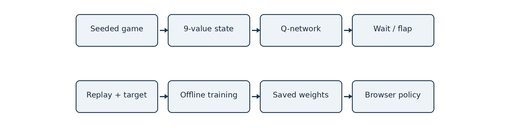
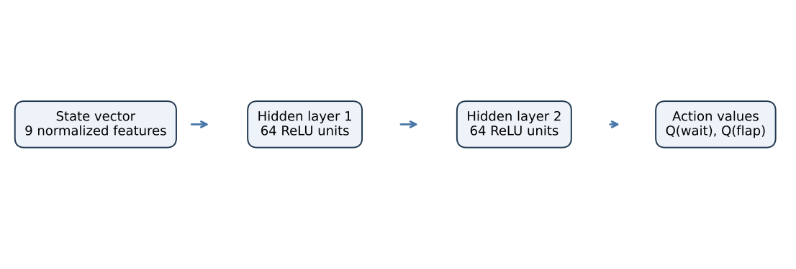
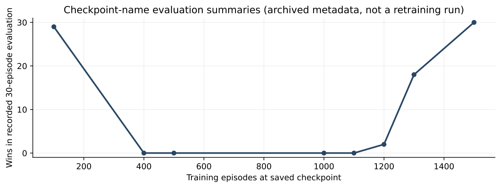

# Flappy NN: Deep Q-Learning in a Deterministic Browser Game

**Ali Baki · Technical project report · October 2026**

## Abstract

Flappy NN couples a deterministic Flappy-style physics environment with a fully connected Deep Q-Network (DQN) trained in TypeScript. Its browser application runs a human-controlled bird and a frozen neural-network opponent on independently simulated copies of the same seeded obstacle field. The agent observes a nine-element normalized state vector and predicts action values for two discrete controls, wait and flap. A manually implemented $9$--$64$--$64$--$2$ network supplies $4{,930$ trainable parameters, ReLU activations, forward inference and backpropagation. Offline training combines a replay buffer, reward shaping, epsilon exploration and periodically synchronized target weights. Model weights are saved as JSON and loaded for inference without browser-time learning. This report defines the game dynamics, state and reward formulation, Bellman updates, implementation architecture and evaluation protocol. Archived evaluation records report $30/30$ successful 1,000-pipe runs; their evidence and limits are distinguished from independent test results.

# Introduction

Flappy NN is a compact reinforcement-learning system in which a learned controller acts within a two-dimensional obstacle-avoidance game. The challenge is not image classification or a hand-authored rule such as “flap when below the gap.” At each simulation step, the controller chooses between maintaining ballistic motion and applying an upward impulse, and must survive a procedurally generated succession of pipe pairs. The web application places this learned policy beside a human player for a direct comparison under matching environmental parameters.

The project implements both the environment and a neural Q-function in TypeScript. Training runs in terminal scripts; evaluation disables exploration and learning; public gameplay loads a saved parameter file rather than retraining it. This separation makes the published model an explicit artifact of an offline optimization process, not a web interface with a continuously mutable policy. The technique follows the value-based reinforcement-learning approach exemplified by DQN , but the implementation here uses a compact engineered state representation rather than pixels.

The central system consists of a reproducible game simulator, a nine-dimensional observation map, a feed-forward value function, a replay-based trainer, evaluation utilities, and a Next.js application. A fixed terrain seed induces the same pipe positions, gaps, gravity and collision geometry in both competitors. Importantly, this is the same *environment*, not synchronized bird motion: each bird has its own state and actions.

# System Organization

Figure Figure flappy-pipeline separates offline learning from deployed inference. The shared `flappyEngine.ts` updates state without depending on the rendering framework. `terrain.ts` converts a string seed into a deterministic terrain plan. `simpleNetwork.ts` implements all dense layers and gradient updates. `dqnAgent.ts` maintains online and target networks and the replay memory, while `train-cpu.ts` defines exploration, rewards, evaluation intervals and checkpoint persistence. The browser reads `cpu-model.json` through `loadCpuModel.ts` and only calls the model for greedy decisions.

*System architecture and data flow.*

| Component              | Main role                               |
|:-----------------------|:----------------------------------------|
| `core/config.ts`       | Geometry, dynamics and action constants |
| `core/terrain.ts`      | Seeded pipe generation                  |
| `core/flappyEngine.ts` | Stepping, collision, score, observation |
| `ai/simpleNetwork.ts`  | Fully connected forward/backward pass   |
| `ai/dqnAgent.ts`       | Replay and target-network Q-learning    |
| `scripts/train-cpu.ts` | Learning loop and checkpoints           |
| `scripts/eval-cpu*.ts` | Non-learning policy evaluation          |
| `game/VsCpuGame.tsx`   | Browser match and rendering controls    |
| `public/models/`       | Runtime weights and archived artifacts  |

Code Organization and Responsibility

# Game as a Control Environment

## State transitions

The simulator uses a play field of 420 by 600 units, with a 78-unit floor. The bird’s horizontal coordinate is fixed at 112. Its vertical position $y_t$, velocity $v_t$, frame count, horizontal world-scroll offset and score evolve under a discrete action $a_t\in\{0,1\}$, where 0 means wait and 1 means flap. The update implemented by `stepGame` is 

$$
\begin{aligned}
\tilde v_t &= \begin{cases}-6.4,&a_t=1,\\v_t,&a_t=0,\end{cases}\\
v_{t+1}&=\tilde v_t+0.34,\\
y_{t+1}&=y_t+v_{t+1},\\
x^{\rm scroll}_{t+1}&=x^{\rm scroll}_t+1.95.

\end{aligned}
$$

 Thus an action resets upward velocity before gravitational acceleration, not after it. The physics are expressed per simulation step rather than in world units per second. Browser updates use an accumulator targeting 112 fixed simulation steps/s with bounded catch-up. Evaluation scripts call the same stepping function directly, so their logical outcomes are based on frames, not display refresh rate.

The engine increments score after a pipe’s right edge passes the bird’s horizontal position. A run terminates on a ceiling, floor, or pipe collision. The bird hitbox is elliptical with horizontal and vertical radii 17 and 14, respectively. Pipe overlap is tested against the nearest point on each rectangle to the ellipse center, using 

$$
\left(\frac{c_x-x_b}{r_x}\right)^2+\left(\frac{c_y-y_b}{r_y}\right)^2\leq 1.
$$

 A four-unit grace inset on pipe bounds makes the collision geometry slightly more forgiving than the drawn rectangles. That rule is common to training, evaluation and browser gameplay.

## Deterministic obstacle generation

A string seed is hashed using a 32-bit multiplication/XOR recurrence, then passed to a `mulberry32` pseudorandom generator. By default 5,000 pipes are precomputed. Adjacent pipes begin 275 units apart; the first starts at 350. Each gap size is uniformly sampled from 150 to 190, and its center is sampled within bounds that leave clearances from the top and floor. Two games built from the same seed therefore receive exactly the same pipe plans and hitboxes, allowing controlled player-versus-CPU comparison.

Determinism holds for the environment given a seed, engine version and sequence of actions. It does not make random training reproducible by itself: network initialization, replay sampling, exploration, and random evaluation seeds use separate randomness that is not globally seeded in the supplied scripts.

# State Representation

The learned policy does not inspect the canvas image. The function `getAiState` transforms simulator values into the normalized vector $s_t\in\mathbb{R}^{9}$. Let $d_x$ be the horizontal distance from the bird to the next pipe, $y_g$ its gap center, $g$ its gap size, and $v_p=1.95$ the pipe-scroll speed. Then 

$$
\small
s_t=\left[\frac{y_t}{600},\frac{v_t}{10},\frac{d_x}{420},\frac{y_g}{600},\frac{y_t-y_g}{600},\frac{v_p}{6},\frac{g}{600},\frac{d_x/v_p}{120},a_{t-1}\right].
$$

 The elements encode altitude, momentum, proximity to the next obstacle, target height, signed alignment error, scrolling rate, clearance size, approximate time to contact, and prior action. Several terms are deliberately redundant (e.g., distance and time to pipe), but the small network can learn dependencies among them. Divisors impose stable numeric scales rather than guaranteeing strict $[0,1]$ bounds in every state.

A vector observation reduces the learning problem relative to pixels because perception is supplied by the simulator. This is a valid control benchmark, but its scope differs from end-to-end visual reinforcement learning, where the agent must infer geometry from images. The last action also introduces a short memory signal without using a recurrent network.

# Neural Q-Function

## Architecture and parameter count

The value approximator is a fully connected feed-forward network with widths $9\rightarrow64\rightarrow64\rightarrow2$. The first two affine layers use ReLU; the output layer is linear. For input $s$, 

$$
\begin{aligned}
h_1&=\max(0,sW_1+b_1),\\
h_2&=\max(0,h_1W_2+b_2),\\
Q(s,\cdot)&=h_2W_3+b_3.
\end{aligned}
$$

 The final pair is $(Q(s,\mathrm{wait}),Q(s,\mathrm{flap}))$, not a normalized probability distribution. The greedy action chooses the larger Q-value, with ties favoring wait. The number of trainable parameters is 

$$
(9\cdot64+64)+(64\cdot64+64)+(64\cdot2+2)=4{,}930.
$$

 Weights are initialized with uniform random values scaled by $\sqrt{2/n_{\rm in}}$; biases begin at zero. The implementation performs matrix-vector operations with nested TypeScript arrays rather than calling a deep-learning runtime.

*State-to-action-value mapping of the deployed network. The figure depicts layer widths, not individual neurons or synapses.*

## Manual forward and backward propagation

`SimpleNetwork.trainOne` calculates the forward pass and cached preactivations, then minimizes a half-sum-of-squared-errors objective for a supplied two-element target: 

$$
L(s,y)=\tfrac12\sum_{a\in\{0,1\}}(Q(s,a)-y_a)^2.
$$

 The derivative of the output $Q-y$ is propagated backward through the linear output layer, then through ReLU masks $\mathbf{1}[z>0]$ in the hidden layers. Gradients for each matrix use the outer product of layer inputs and their error signal, and parameters are updated with ordinary stochastic gradient descent. There is no external automatic differentiation framework, Adam optimizer or gradient clipping in the reviewed source. This makes the model small and inspectable, but imposes the usual numerical and optimization limitations of an elementary unbatched implementation.

# Replay-Based Q-Learning

## Bellman targets and synchronization

A transition consists of $(s_t,a_t,r_t,s_{t+1},d_t)$, with $d_t$ indicating terminal or target-score completion. The trainer adjusts only the chosen action target; other actions retain their predicted values. With discount $\gamma=0.97$, 

$$
y_{a_t}=\begin{cases}r_t,&d_t=1,\\r_t+\gamma\max_aQ_{\bar\theta}(s_{t+1},a),&d_t=0.\end{cases}
$$

 Here $\theta$ denotes online-network parameters and $\bar\theta$ a periodically copied target network. Every 400 individual transition updates, the target weights are replaced with the online weights. This is *standard target-network DQN*, not Double DQN: the target also selects the maximizing action. The loss is squared error as in (equation flappy-mse), not Huber loss.

## Experience memory

Transitions are held in a 30,000-entry FIFO-style replay array. Once 64 entries are available, one call to `train(25)` draws 25 groups of 64 transitions, with uniform random sampling *with replacement*. Every sampled transition triggers an immediate `trainOne` update; thus one call may issue 1,600 parameter updates and crosses several 400-update target synchronization boundaries.

High-reward transitions are overrepresented deliberately. A transition with reward $\geq10$ is stored nine times total, and one with reward $\geq4$ but less than 10 is stored four times total. This crude rare-event replay strategy improves visibility of successful obstacle crossings, but introduces a nonuniform empirical replay distribution and should not be mistaken for formal prioritized experience replay with corrected sampling weights.

## Exploration

The actual `train-cpu.ts` script sets epsilon to 0.25 initially, decaying toward a minimum of 0.04 by a factor 0.9997 once per training call. During exploration the trainer samples $a=\mathrm{flap}$ with probability 0.045 and $a=\mathrm{wait}$ otherwise, instead of selecting each random action with equal probability. Outside exploration it chooses the current greedy action. This bias reflects the short action duration of flaps relative to waiting and avoids the near-certain failure caused by uniformly frequent random flaps; it is still reinforcement learning rather than scripted imitation.

# Reward Specification

The effective reward used for offline training is defined inside `scripts/train-cpu.ts`. With score increment $\Delta c$, indicator $f$ for a flap, terminal indicator $d$, success indicator $w$, and clipped alignment distances $z_t=\min(1,|s_t[4]|)$, 

$$
\begin{aligned}
r_t = {}& 0.02+1.2(z_t-z_{t+1})+0.04(1-z_{t+1})\\
&+18\Delta c-0.015f-10d+40w.
\end{aligned}
$$

 The terms encourage survival, progress toward the gap center, proximity to the next gap, successful pipe passage, action economy, and completion of the 30-pipe training target. The last two positive event rewards are sparse; the dense shaping signals supply feedback between pipe crossings. The observation normalization makes these components dimensionless but their coefficients remain hand-selected design hyperparameters.

A separate `src/game/ai/reward.ts` exports a different helper reward function, including a human-source bonus. It is *not* imported by the supplied `train-cpu.ts` training script. Describing that helper as the active training objective would therefore be incorrect. The current browser does not update learned parameters from human demonstrations.

| Setting                           |               Value |
|:----------------------------------|--------------------:|
| Episode score target              |            30 pipes |
| Maximum episode length            |        5,000 frames |
| Replay memory capacity            |              30,000 |
| Sample size / train calls         | 64 / 25 per episode |
| Target sync interval              |  400 sample updates |
| Discount $\gamma$                 |                0.97 |
| SGD learning rate                 |             0.00008 |
| Exploration $\epsilon_0$, floor   |          0.25, 0.04 |
| Epsilon decay per train call      |              0.9997 |
| Random flap probability           |               0.045 |
| Checkpoint evaluation cadence     |        100 episodes |
| Evaluation episodes at checkpoint |                  30 |

Training Hyperparameters in `train-cpu.ts`

# Training, Evaluation and Persistence

## Training loop

Each training episode creates a new environment seeded as `dqn-{episode}`. The loop observes the current vector, selects an action using epsilon-biased exploration, advances the environment, computes reward (equation reward), and stores a transition. Once an episode ends, 25 replay minibatch groups update the online network. Every 100 episodes, a separate greedy evaluation uses 30 fixed-by-construction evaluation seed strings derived from the episode count; model files are saved when the reported lexicographic ranking over wins, average, minimum and maximum improves and at least one successful pipe has been traversed. Running `train:cpu` may load and overwrite `public/models/cpu-model.json`; copying it first is necessary to preserve the deployed agent.

## Evaluation methodology

The deterministic evaluation script creates 30 games with the same seed derivation scheme on every run, while `eval-cpu-random.ts` chooses fresh UUID-based seeds. Both disable epsilon exploration and learning. The latter accepts episode count, score target and frame cap as command-line arguments, and records seed, frames, score, and termination reason for each run. A successful result means reaching the requested pipe count before a crash or frame cap. This is an operational success criterion, not a global measure of general intelligence.

| Recorded runs | Target score | Wins | Crashes / caps |
|--------------:|-------------:|-----:|---------------:|
|            10 |        1,000 |   10 |          0 / 0 |
|            30 |        1,000 |   30 |          0 / 0 |

Archived Random-Terrain Evaluations

The repository contains two archived JSON files dated May 23, 2026. As summarized in Table 3, they record 10/10 and 30/30 successful random-terrain episodes, each at target score 1,000. All recorded successful episodes have a score of 1,000 and 141,030 logical frames, reflecting the regular fixed spacing between pipes. These are *archived run records*; this report inspects their contents but does not claim to have rerun all 40 episodes. Neither record provides a confidence interval, held-out distribution specification beyond seed generation, or evidence about substantially different physics.

## Checkpoint evidence

The preserved training checkpoint filenames encode an episode label and local 30-episode evaluation summary. Figure 2 extracts those labels. The filenames cover several intermediate performances, including a 30/30 checkpoint labeled episode 1,500 and a 29/30 one labeled episode 100. Because only selected saved snapshots are present and the full training log and global random seeds are not archived, this graph must not be read as a continuous training learning curve or proof that every checkpoint belongs to one uninterrupted training run.

*Checkpoint filename metadata: recorded wins among 30 evaluation episodes for eight retained unique checkpoints. This is not a fresh training run or a complete history.*

# Browser Inference and Interaction

The Next.js application uses React components for visual rendering, keyboard/pointer controls, session statistics and match presentation. `VsCpuGame.tsx` constructs two independent runtime instances with a shared seed, starts frames using an animation callback, and advances the simulation at a nominal fixed step of 112 Hz. The user triggers flap by Space, Arrow Up or a pointer interaction; the CPU calls `chooseAction(state,false)` on the loaded network. A new match may be started with a new seed. Session results are stored in browser `sessionStorage` and do not change the exported neural weights.

The model loader fetches `/models/cpu-model.json` and validates the declared architecture when loading weights into the DQN agent. Model loading is asynchronous; the reviewed component instantiates an initially randomized network and does not visibly gate match start on successful loading. A match started too early, or after a load failure, could therefore run a randomly initialized CPU rather than the intended frozen trained opponent. This is an operational edge case worth resolving before relying on the live app for formal human-model comparisons.

# Efficiency and Engineering Trade-offs

A single forward pass performs on the order of $9\cdot64+64\cdot64+64\cdot2=4{,}800$ multiply-accumulate products, plus biases and nonlinearities. This is modest for browser inference. Its serialized 4,930 floating-point values are stored in JSON; parse and load are one-time tasks per page session. Training is comparatively expensive because every sampled transition performs a full forward/backward update using nested TypeScript arrays. Neither matrix operations nor replay sampling are vectorized through a tensor library.

The deterministic simulator and representation permit reproducible policy evaluations for fixed seeds, even though training itself is not fully deterministically seeded. Keeping the environment separate from React makes it possible to run many evaluations headlessly with the same rules as the browser. However, generating 5,000 planned pipes and scanning or filtering them during simulation is not asymptotically minimal; it is a straightforward small-environment engineering choice rather than a claim of optimal engine performance.

# Scope and Limitations

Success on procedurally generated but fixed-mechanics Flappy terrain does not imply transfer to unseen action spaces, visual input, different gravity, faster scrolling, or adversarially chosen gap patterns. The agent relies on hand-engineered geometric features that are not available in arbitrary games. The Q-values are useful for action ranking but are not calibrated probabilities of survival. Reward shaping biases which behavior is learned, and an unseeded exploration/replay process prevents exact regeneration of stored weights from a simple episode-count command.

The reviewed implementation uses ordinary target-network DQN and squared-error loss; it does not implement Double DQN, Huber loss, prioritized replay with importance corrections, imitation learning, or browser-time online learning. An older file named `cpuModel.ts` contains a heuristic action function but is not imported by the principal game. It is separate from the deployed learned opponent. Some Next.js routes are placeholders and should not be construed as implemented multi-player or laboratory systems.

# Reproducibility and Code Map

For local inspection, install dependencies using `npm ci` with the Node.js version used by the Docker image (22). Run `npm run dev` for the browser and `npm run build` for a production bundle. Existing model inference reads `public/models/cpu-model.json`. Evaluation uses `npm run eval:cpu` or `npm run eval:cpu:random – 30 1000`; both evaluate the saved weights without training. `npm run train:cpu – 5000` trains and may replace the canonical model, so a reproducible comparison requires preserving the supplied JSON weights and recording the new random seeds and code revision.

The key implementation entry points are listed in Table 1. The checkpoints and evaluation JSON files are retained as data artifacts; their documented summaries remain distinguishable from new experiments. A more complete robustness study would compare multiple independently trained seeds and agents, report learning curves and confidence intervals, and vary gap distribution, gravity, observation noise and inference latency.

# One Complete Reinforcement-Learning Update

Consider one stored transition in which the previous nine-dimensional state is $s$, the action is flap, the reward is $r=0.03$, and the episode has not ended. Suppose the target network predicts $Q_{\bar\theta}(s',\mathrm{wait})=0.7$ and $Q_{\bar\theta}(s',\mathrm{flap})=1.2$. With the configured discount $\gamma=0.97$, the Bellman target for flap is 

$$
y_{\rm flap}=0.03+0.97(1.2)=1.194.
$$

 The current prediction for wait is copied into the two-value training target without modification, while the flap target becomes 1.194. If the current online network predicted $Q_\theta(s,\mathrm{flap})=0.9$, its direct squared-error contribution would be $\frac12(0.9-1.194)^2=0.043218$. Backpropagation changes weights in all three layers so that subsequent predictions for this transition move toward the computed target. These numbers are illustrative; the script computes its targets from real sampled transitions, not fixed constants.

For a terminal crash transition, the bootstrap term is removed: the target is only the observed reward. A completed 30-pipe training episode is also marked terminal by the trainer, even if the physical simulator would permit further obstacles. This distinction matters: the model is optimized on episodes with an explicit 30-pipe goal, while the separate archived benchmark asks it to sustain control for 1,000 pipes. The latter is a longer-horizon evaluation of the same greedy policy, not an alternate objective used in the supplied training script.

Because `DqnAgent.train` takes one gradient step per sampled transition, not one matrix batch update, the effective learning dynamics depend on the order and multiplicity of samples. In addition to this order, the target network is synchronized every 400 transition steps. The interim target values change only at synchronization events while the online parameters change after every sample. This lag is the stabilization mechanism. It does not remove the approximation error from bootstrapping on the agent’s own estimates.

# Determinism, Fairness and Experimental Controls

Two competitors receive identical world layouts because `createMatch` invokes `createGame(seed)` for both and the terrain function is a deterministic function of that seed. Score, collisions, and pipe passage are computed by the same core implementation. This gives the comparison a clear environmental control: different outcomes are attributable to action sequences under a shared simulator, not different obstacle sequences or physics implementations.

The controlled layout is not equivalent to a controlled reaction-time experiment. Human input depends on keyboard and pointer event timing, browser display latency, attention, and familiarity with the game. The model reacts to a normalized internal state on every simulation step, while a person interprets rendered frames. Thus the website can illustrate learned control and compare game outcomes, but a formal human-versus-AI superiority claim would require specifying input latency, practice duration, evaluation seeds, participant population and statistical confidence.

In the terminal evaluator, a run is deterministic once seed, model parameters and simulator implementation are fixed. The model’s action selection is greedy with exploration off, and it does not change parameters. This makes saved failure seeds useful for debugging. Conversely, training is not fully seeded: JavaScript’s random generator initializes network weights and samples replay entries, and the prescribed exploration behavior also uses it. Repeating `train:cpu` with the same episode count can therefore produce a different model unless those stochastic sources and the initial weight snapshot are controlled.

# Saved Model Format and Verification

The saved JSON object specifies `version=1`, the four layer sizes and six weight/bias arrays `w1`, `b1`, `w2`, `b2`, `w3`, and `b3`. Metadata may include epsilon and cumulative train-step count. Import validates the declared layer sizes and copies the arrays into the online network; the target network is then synchronized from the loaded online network. A release of the browser opponent can therefore be identified by the exact bytes or a cryptographic digest of `public/models/cpu-model.json`.

The released source retains eight distinct checkpoint JSONs and the canonical deployed model, totaling nine distinct model contents. Their descriptive filenames encode evaluation summaries but do not establish a complete provenance chain without the training logs and random generator states. Some aliases were redundant byte-identical copies and were removed from the tidied source without changing the canonical model. Evaluation reports are separate JSON records and should not be confused with parameter snapshots.

The browser loader validates only the declared network architecture before loading arrays. An independent integrity test should also count the actual nested weight values, verify finite numeric elements, and check a published model digest. Such defensive validation would improve handling of malformed or substituted model files; it is not part of the reviewed application and no claim of that protection is made here.

# Interpreting the Reported Performance

Both archived 1,000-pipe evaluations have zero reported crash and frame-cap outcomes. Since pipe spacing is fixed, a fully successful run reaches exactly the requested target after the same number of logical frames, regardless of the random gap centers. The identical frame counts in the logs therefore do not imply identical terrain. What differs is the generated sequence of gaps and the resulting action choices, which the compact summary does not expose.

The success fraction from 30 trials is a finite-sample observation under one particular procedural distribution. It does not establish a worst-case guarantee or success on distributions with smaller gaps, different pipe speed or noisy state observations. A stronger study would evaluate multiple independently trained model instances on predeclared seed sets, measure partial scores of failures, publish exact weight digests, and report whether any seeds were reused during tuning. The current artifacts are sufficient for a concrete source-grounded engineering account; they are not a substitute for that larger experiment.

# Simulation Cost and Scalability

The generated terrain is a finite plan of 5,000 pipes. On each simulator step, `getVisiblePipes` maps across the plan before filtering to the current viewport, and `updateScore` filters the same plan to count passed pipes. These straightforward scans make each frame’s terrain processing proportional to the total planned pipe count in the reviewed implementation, rather than only the visible obstacles. For a browser demonstration this is manageable under the intended runtime conditions; for large-scale reinforcement-learning experiments, advancing a current-pipe index and maintaining a small moving window would reduce repeated work.

Such a change would be an engine optimization with potential effects on corner cases and timing, not mere documentation cleanup. It would require equivalence tests on seeded trajectories before replacing the existing logic. The present report describes the simulator actually supplied with the project, and its archived evaluation numbers correspond to that implementation. Similarly, vectorized batch training or a compiled tensor runtime could accelerate learning, but would no longer be the manually implemented training mechanism that this project is intended to demonstrate.

# Conclusion

Flappy NN is an integrated control-learning application with its own deterministic game environment, explicit state design, neural Q-value approximator, manual gradient computation, replay-based offline training, saved model checkpoints and a separate browser inference path. Its principal value lies in making the boundary between game dynamics, reinforcement learning and deployed AI observable and inspectable. The archived evaluations support high success rates for the tested game configuration, but broader claims require controlled retraining and held-out perturbation studies.

9 V. Mnih *et al.*, “Human-level control through deep reinforcement learning,” *Nature*, vol. 518, pp. 529–533, 2015, doi: 10.1038/nature14236. R. S. Sutton and A. G. Barto, *Reinforcement Learning: An Introduction*, 2nd ed., MIT Press, 2018. L.-J. Lin, “Self-improving reactive agents based on reinforcement learning, planning and teaching,” *Machine Learning*, vol. 8, pp. 293–321, 1992. A. Baki, “Flappy NN: Source code,” Hugging Face Spaces, <https://huggingface.co/spaces/abp89aa/flappy-nn>, accessed Oct. 2026.

## References

1. V. Mnih et al., *Human-level control through deep reinforcement learning*, Nature 518, 529–533 (2015). https://doi.org/10.1038/nature14236
2. R. Sutton and A. Barto, *Reinforcement Learning: An Introduction*, MIT Press, 2018.
3. L.-J. Lin, *Self-improving reactive agents based on reinforcement learning, planning and teaching*, Machine Learning 8 (1992).
4. Source repository. https://huggingface.co/spaces/abp89aa/flappy-nn
